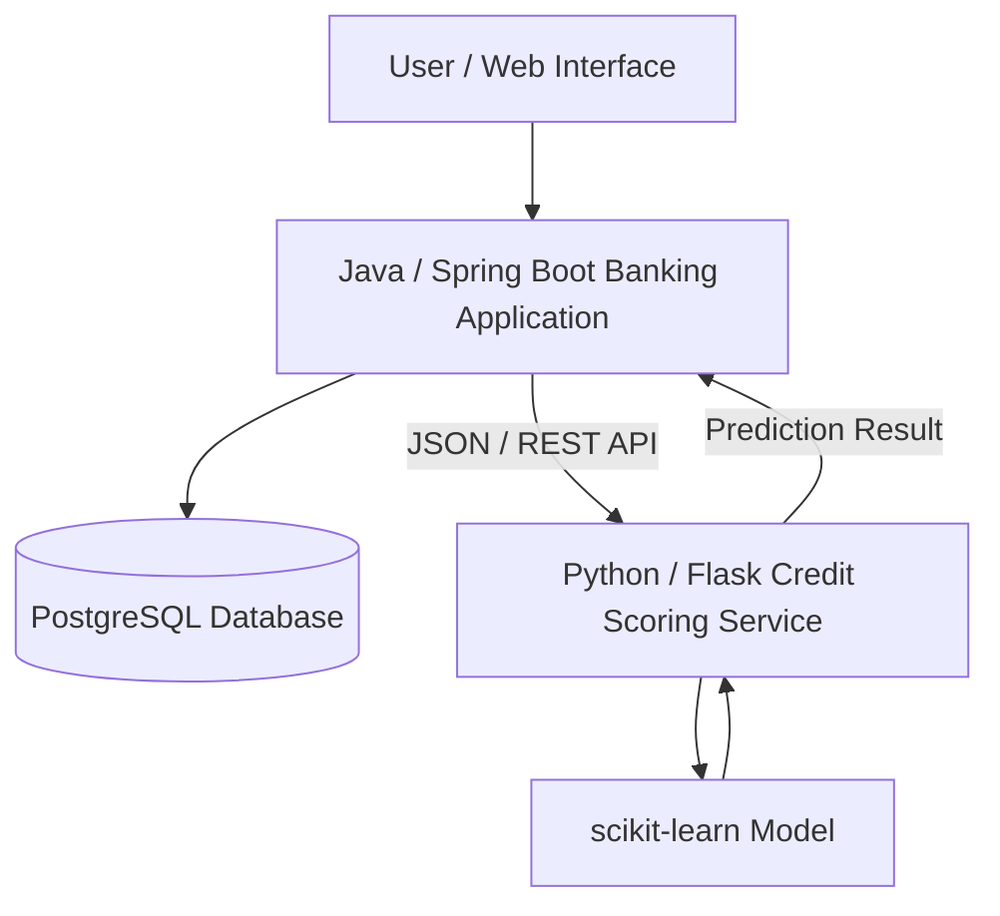
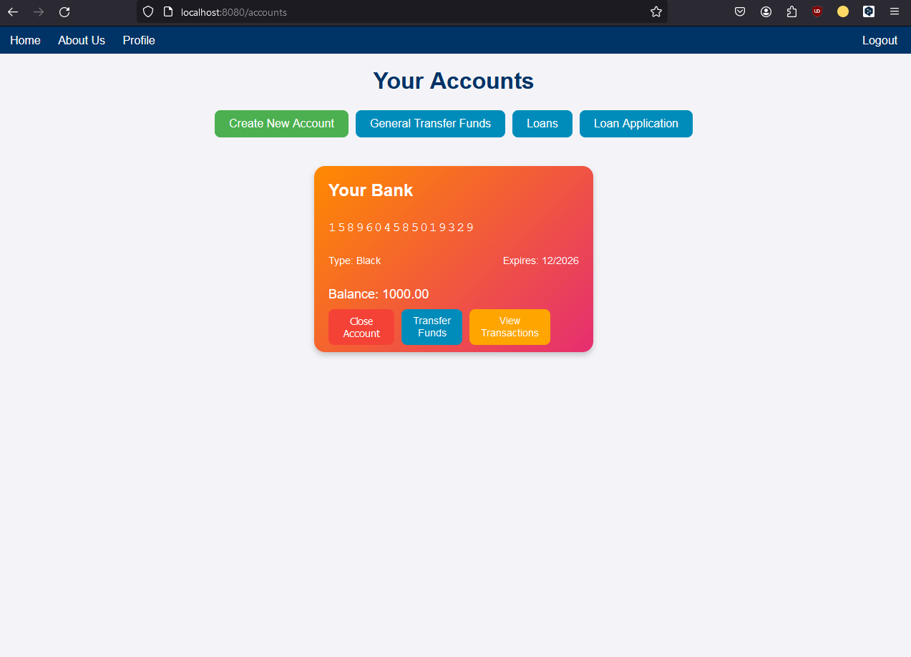
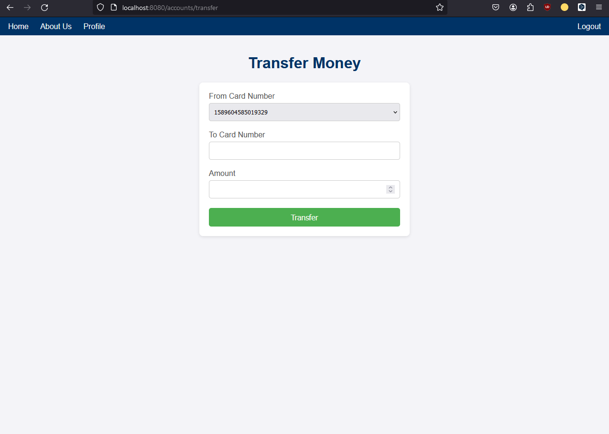
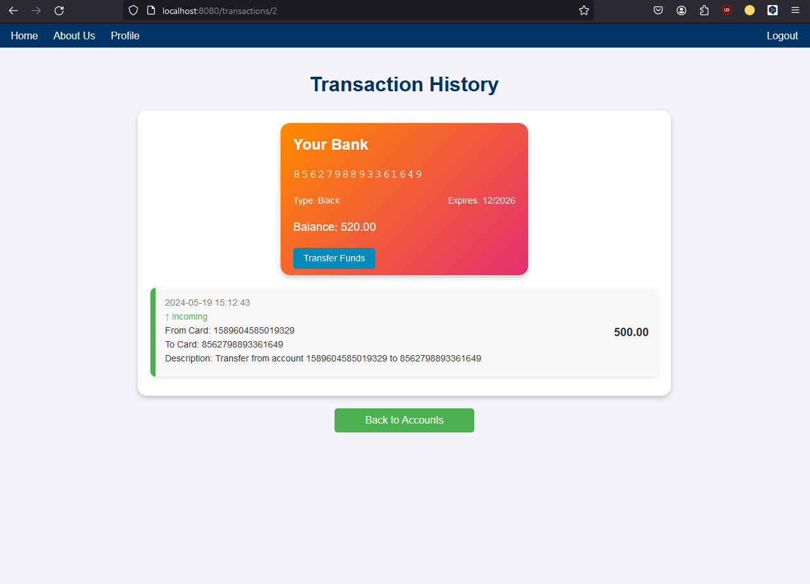
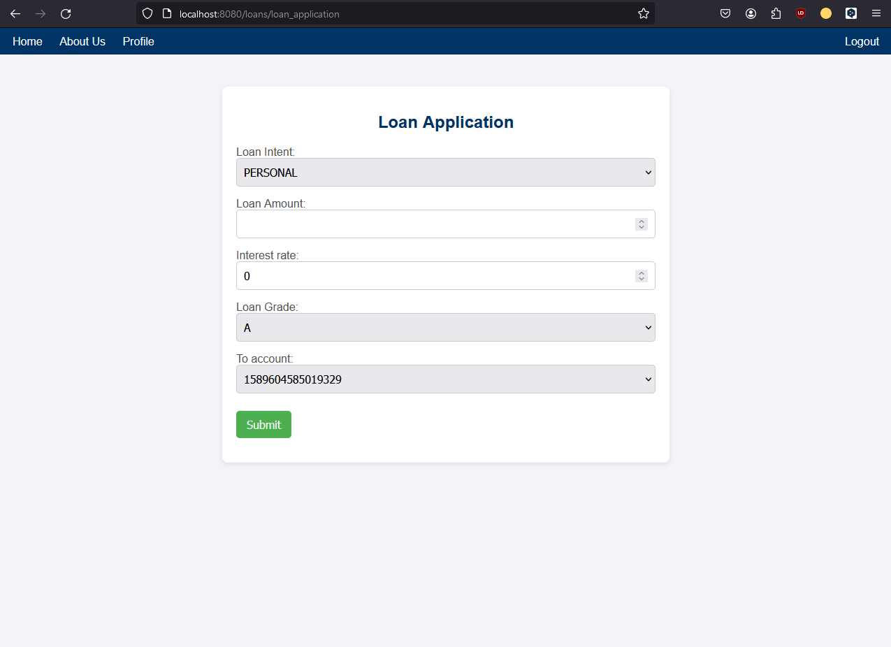
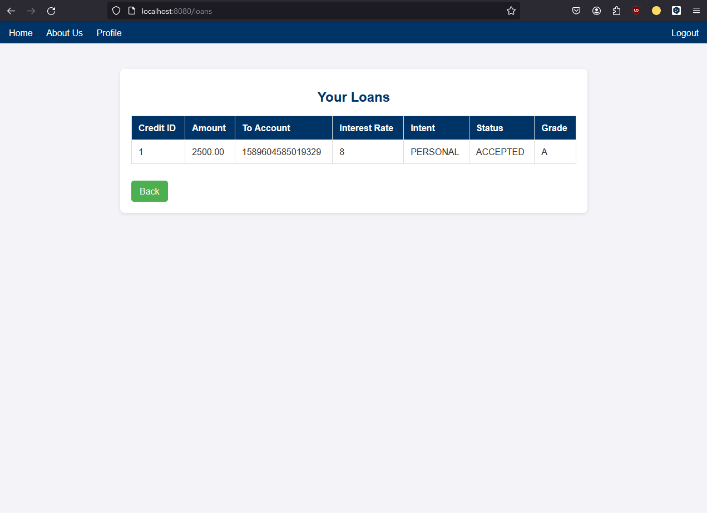

# Banking Simulation & ML Credit Scoring

A full-stack banking web application with an integrated machine learning service for automated credit scoring.

The project combines a **Java / Spring Boot banking application**, a **PostgreSQL database**, and a separate **Python / Flask machine learning service**. The services communicate through a REST API and can be orchestrated with Docker Compose.

> Academic project developed as part of a Bachelor's degree in Applied Mathematics.

## Overview

The application simulates core banking operations while also demonstrating how a machine learning service can be integrated into a traditional web backend.

Users can create and manage accounts, transfer funds, review transaction history, submit loan applications, and receive a credit decision produced by a separate ML-based scoring service.

The system is split into three main components:

1. **Banking application** — handles users, accounts, transactions, loan workflows, and application business logic.
2. **PostgreSQL database** — stores users, accounts, transactions, loan applications, and scoring results.
3. **Credit scoring service** — a Python/Flask service that receives applicant data through a REST API and returns a creditworthiness prediction.

## Architecture



The Java application is responsible for the main banking logic and sends loan applicant data to the Python service in JSON format. The scoring service processes the request with a trained scikit-learn model and returns the prediction to the banking application.

Docker Compose is used to simplify orchestration of the application components and their communication.

## Main Features

- User registration and authentication
- Bank account creation and management
- Account balance management
- Transfers between accounts/cards
- Transaction history
- Loan application workflow
- Automated creditworthiness assessment
- Storage and display of credit scoring results
- REST API communication between Java and Python services
- Multi-container deployment with Docker Compose

## Technology Stack

### Backend
- Java
- Spring Boot
- Spring Security
- Hibernate / JPA
- REST API

### Database
- PostgreSQL

### Machine Learning Service
- Python
- Flask
- scikit-learn

### Frontend
- Thymeleaf
- HTML
- CSS
- JavaScript
- Bootstrap

### Infrastructure
- Docker
- Docker Compose

## Credit Scoring

Several classification approaches were evaluated for the scoring module:

- Logistic Regression
- Decision Tree
- Random Forest
- Gradient Boosting

The **Random Forest** model was selected for the final credit scoring module. In the project evaluation, it achieved approximately:

- **Accuracy:** 0.927
- **Recall:** 0.990
- **F1 score:** 0.955

The scoring module is intentionally separated from the main Java application. This keeps the ML logic independent from the banking backend and allows the Java service to interact with it through a simple REST interface.

## Application Screenshots

### Accounts

The main account dashboard allows users to create accounts, initiate transfers, access loans, and review transactions.



### Money Transfer

Users can select a source account/card, specify a destination, and transfer funds.



### Transaction History

Each account maintains a transaction history with information about incoming and outgoing operations.



### Loan Application

Users can submit a loan request directly from the banking application.



### Loan Results

Processed loan applications can be reviewed together with their status and related loan information.



## Project Flow

A typical credit application follows this flow:

1. The user fills in a loan application in the banking web application.
2. Spring Boot collects the required applicant information.
3. The backend serializes the data and sends it to the Python scoring service through REST.
4. The Flask service loads the trained scikit-learn model and performs prediction.
5. The prediction result is returned to the Java application.
6. The banking application stores and displays the resulting credit decision.

## Running the Project

The project was designed to run as a multi-component system using Docker Compose.

A typical startup command is:

```bash
docker compose up --build
```

Exact database credentials, ports, environment variables, and local configuration should be checked in the repository configuration before running the application.

## Project Purpose

This project was created to demonstrate the integration of:

- backend web development;
- relational databases;
- REST-based service communication;
- machine learning;
- containerization;
- and a practical banking workflow

within one application.

It is an **academic banking simulation**, not a production banking platform.

## Author

**Illia Prikhno**

- GitHub: https://github.com/goodillich2
- LinkedIn: https://www.linkedin.com/in/goodillich
